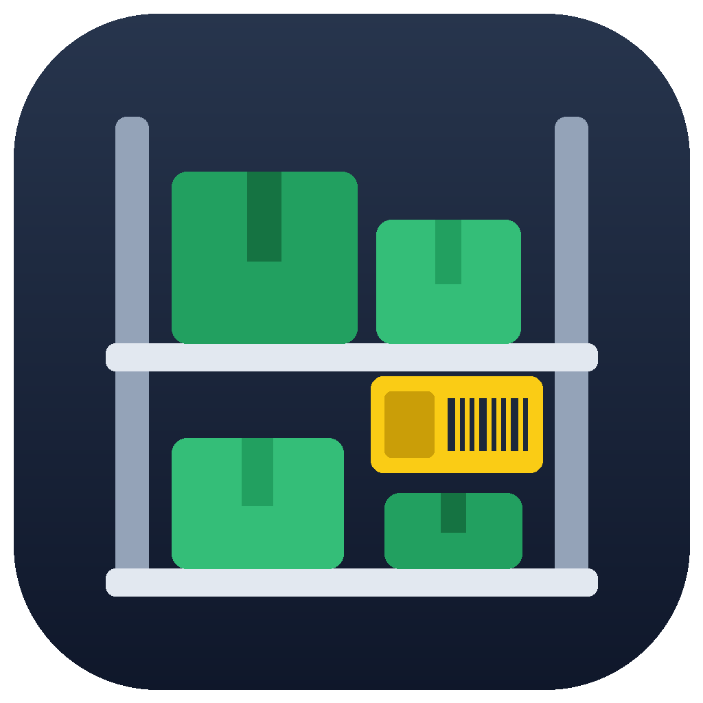

# Backroom Suite

Back-office tools for stores running AEPOS (AdvEntPOS). Backroom Suite is independent software and
isn't made or supported by AdvEntPOS.

## Install

1. Go to **[Releases](../../releases/latest)** and download `BackroomSuiteSetup-x.y.z.exe`.
2. Run it and tick the apps you want.
3. When it opens, connect to your store's AEPOS database (SQL Server, or Postgres for cloud-hosted stores).
   You only do this once: every app uses the same connection.
4. The suite checks the database looks like AEPOS, then installs the apps you picked.

The hub keeps itself and the apps up to date.

## Apps

| App | What it does | Databases |
|---|---|---|
| Vendor File Formatter | Formats vendor product lists, invoices and open orders, and fills in item info from AEPOS | SQL Server |
| Backroom Inventory | Counts, adjustments, receiving and transfers, staged and reviewed before they go into AEPOS; count from a phone | SQL Server, Postgres |

## Extras

| Extra | What it is |
|---|---|
| AzureLabel shelf tag templates | Label templates and the AEPOS item query, for use in AzureLabel (bought separately from azurelabel.com; barcodes need its Pro license). Get them from **Extras** in the hub. |

## Before you start

- Windows 10 or 11, 64-bit.
- A login to your AEPOS database. The apps that change inventory always show you the changes before writing them.
- Back up your AEPOS database before using any tool that writes to it.
